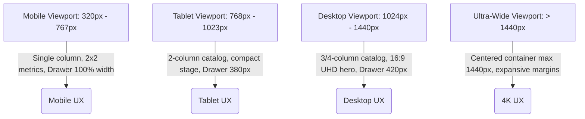

# Design Requirements Document (DRD)

## Project Name: KENT Water Purifiers — Design System & Visual Architecture
**Document Version:** 1.0.0  
**Status:** Approved / Active Production  
**Scope:** Design Language, Component System, Responsive Layouts, UI Tokens, and UX Specifications  
**Last Updated:** November 2026  

---

## 1. Design Philosophy & Aesthetic Pillars

The design language of the KENT digital platform blends **contemporary architectural minimalism** with **editorial wellness luxury**. It moves away from cold, clinical appliance aesthetics toward a warm, human-centered, premium consumer lifestyle experience.

### Core Visual Pillars:
1. **Architectural Purity**: Clean horizontal planes, pure white backgrounds, warm travertine stone textures, and subtle sunlit water caustics.
2. **Liquid Elegance**: High-speed photographic water physics with crystal-clear refractions, micro-droplets, and dynamic fluid arcs framing products.
3. **Warm Luxury Palette**: An intentional shift from generic teal/medical blue toward regal burgundy, ruby wine, and warm brushed champagne gold.
4. **Editorial Typography**: Pairing a distinguished high-contrast serif display typeface with an ultra-legible humanist sans-serif for interface clarity.

---

## 2. Color System & Design Tokens

### 2.1 Brand & Accent Colors

```css
:root {
  /* Signature Brand Hues */
  --burgundy: #800020;             /* Regal Signature Burgundy (Primary brand identity) */
  --burgundy-dark: #5A0017;        /* Deep Wine (Hover & pressed CTA states) */
  --burgundy-light: #FDF2F4;       /* Soft Blush Tint (Badge backgrounds & chip selection) */
  --burgundy-border: rgba(128, 0, 32, 0.15); /* Delimiting borders & dividers */

  /* Luxury Accents */
  --gold: #B59E52;                 /* Brushed Champagne Gold (Eyebrow text & icons) */
  --gold-dark: #78642A;            /* Deep Bronze Gold (High-contrast text on light surfaces) */
  --gold-gradient: linear-gradient(135deg, #800020 0%, #A81941 40%, #C04B64 72%, #B98C50 100%);
  
  /* Neutral Architecture & Surfaces */
  --bg-primary: #FFFFFF;           /* Crisp Pure White (Canvas, product stage, cards) */
  --bg-secondary: #FAFAFA;         /* Soft Off-White (Section backgrounds & alternations) */
  --bg-tertiary: #F7F5F0;          /* Warm Alabaster (Pillars, testimonial backdrops) */
  --stone-travertine: #E8E2D5;     /* Warm Polished Travertine (Hero stage plinth) */

  /* Typography Colors */
  --text-primary: #0A0A0A;         /* Charcoal Black (Headings & high-contrast titles) */
  --text-secondary: #555555;       /* Slate Neutral (Body copy & secondary specs) */
  --text-muted: #777777;           /* Cool Gray (Labels, captions, strikethrough MRP) */

  /* Feedback & Utility */
  --success: #10B981;              /* Verified Emerald Green (Stock tags, free delivery) */
  --success-bg: #E8F5E9;           /* Pale Mint (Security badges) */
  --warning: #F59E0B;              /* Amber (Discount countdowns) */
  --error: #EF4444;                /* Crimson Red (Validation error text & borders) */
}
```

### 2.2 Hero Tagline Multi-Stop Gradient Formula
To achieve the luxurious metallic-to-wine transition on the hero headline:
$$\text{Gradient: } 0\% \rightarrow \text{\#800020} \quad 40\% \rightarrow \text{\#A81941} \quad 72\% \rightarrow \text{\#C04B64} \quad 100\% \rightarrow \text{\#B98C50}$$

---

## 3. Typography System

### 3.1 Font Families
* **Display / Editorial Headings**: `'DM Serif Display', Georgia, serif`
  * Applied to: Hero headline, main section titles, brand milestones.
  * Attributes: High vertical contrast, delicate brackets, timeless elegance.
* **Interface / Body / Metadata**: `'Plus Jakarta Sans', system-ui, -apple-system, sans-serif`
  * Applied to: Navigation, CTAs, product specs, pricing, form controls, footer.
  * Attributes: Geometric humanist sans, open counters, tall x-height, exceptional legibility.

### 3.2 Type Scale & Hierarchy

| Element | Font Family | Weight | Size (Fluid Clamp) | Line Height | Letter Spacing |
| :--- | :--- | :--- | :--- | :--- | :--- |
| **Hero Title ("KENT")** | Plus Jakarta Sans | 800 | `clamp(2.5rem, 5vw, 4.2rem)` | 1.05 | `-0.02em` |
| **Hero Tagline L1** | DM Serif Display | 400 | `clamp(1.8rem, 3.2vw, 2.6rem)` | 1.15 | `0` |
| **Hero Tagline L2** | DM Serif Display | 400 (Grad) | `clamp(1.8rem, 3.2vw, 2.6rem)` | 1.15 | `0` |
| **Section Title** | Plus Jakarta Sans | 700 | `clamp(1.6rem, 3vw, 2.2rem)` | 1.20 | `0.02em` |
| **Product Card Title**| Plus Jakarta Sans | 700 | `1.15rem` | 1.25 | `-0.01em` |
| **Body Large** | Plus Jakarta Sans | 400 / 500 | `1.05rem` | 1.60 | `0` |
| **Body Regular** | Plus Jakarta Sans | 400 | `0.92rem` | 1.55 | `0` |
| **Eyebrow / Badges** | Plus Jakarta Sans | 700 | `0.74rem` | 1.00 | `0.18em` (UPPERCASE) |
| **Price Hero** | Plus Jakarta Sans | 800 | `1.35rem` | 1.10 | `-0.02em` |

---

## 4. Spacing System, Elevation & Shadows

### 4.1 Spacing Scale (8pt Grid)
* `xs`: `0.25rem` (4px)
* `sm`: `0.5rem` (8px)
* `md`: `1.0rem` (16px)
* `lg`: `1.5rem` (24px)
* `xl`: `2.0rem` (32px)
* `2xl`: `3.0rem` (48px)
* `3xl`: `4.0rem` (64px)

### 4.2 Inter-Section Spacing Rule
To maintain visual cohesion, the vertical space between the Hero Section Key Metrics Card and the Product Browser header is kept strictly within **`1.5rem` to `1.75rem` (~24px–28px)**.

### 4.3 Realistic Grounding Contact Shadows
Contact shadows for floating product units and hero purifiers are rendered using dual-layer ellipses:
1. **Core Occlusion Shadow**: Directly underneath the rubber feet/base (`rgba(30, 25, 20, 0.45)` with `rx = 0.72 × W`, `ry = 2px`).
2. **Ambient Diffuse Grounding**: Soft radial expansion (`rgba(45, 40, 35, 0.08)` to `0.26`, radius expanding over 12 concentric steps).

---

## 5. Component Specifications

### 5.1 Global Navigation Header
* **Height**: `70px` (Desktop) / `64px` (Mobile).
* **Background**: `rgba(255, 255, 255, 0.94)` with `backdrop-filter: blur(12px)`.
* **Border**: `1px solid rgba(0, 0, 0, 0.06)` along bottom edge.
* **Search Pill**:
  * Pill container with `border-radius: 999px`.
  * Background: `#F5F5F5` transitioning to `#FFFFFF` on focus with Burgundy border ring (`2px solid rgba(128, 0, 32, 0.35)`).
* **Cart Badge**:
  * Positioned absolute top-right of cart icon.
  * Dimensions: `18px × 18px`, circular, background `#800020`, text `#FFFFFF`, bold `11px`.

### 5.2 Hero Stage Showcase Banner
* **Aspect Ratio**: 16:9 panoramic (`1376px × 545px` canvas).
* **Asset Format**: Lossless WebP (`images/kent-purifiers-banner.webp`).
* **Visual Elements**:
  * Left: Brand Lockup (`KENT® HOUSE OF PURITY`), Tagline (`Mineral Technology / Pure Hydration`), Technology descriptor, and 3-column trust metrics.
  * Right: Complete 4-purifier lineup (**Pearl IoT**, **Grand IoT**, **KENT Grand**, **Supreme Plus Neo**) with crystal liquid water arc and grounding contact shadows.

### 5.3 Key Trust Metrics Pill Card
* **Layout**: Horizontal flex row (Desktop) / 2×2 grid (Mobile).
* **Styling**: Pure white `#FFFFFF` surface with `1px solid rgba(0, 0, 0, 0.08)` border.
* **Border Radius**: `16px`.
* **Shadow**: `0 4px 20px rgba(0, 0, 0, 0.04)`.
* **Dividers**: `1px solid rgba(0, 0, 0, 0.09)`, height `28px`.

### 5.4 Product Catalog Cards (`.catalog-card`)
* **Surface**: Crisp white with `border-radius: 16px` and `border: 1px solid rgba(0, 0, 0, 0.07)`.
* **Hover Interaction**:
  * `transform: translateY(-5px);`
  * `box-shadow: 0 16px 36px rgba(128, 0, 32, 0.08);`
  * `border-color: rgba(128, 0, 32, 0.25);`
* **Media Frame**: Square aspect ratio with product centered and subtle background gradient.
* **Pricing Block**:
  * Sale Price: `1.3rem`, bold, `#0A0A0A`.
  * MRP: `0.9rem`, strikethrough, `#888888`.
  * Savings Badge: `rgba(16, 185, 129, 0.12)` background, `#047857` green text, bold `0.72rem`.

### 5.5 Quick View Modal Dialog (`.modal-container`)
* **Backdrop**: `rgba(0, 0, 0, 0.65)` with `backdrop-filter: blur(8px)`.
* **Dialog Shell**: Maximum width `860px`, `border-radius: 20px`, pure white interior.
* **Layout**: 2-column on desktop (Left: Media gallery; Right: Content, specs, pricing, CTA cluster).
* **Quantity Stepper**:
  * Pill container with `36px` height.
  * Minus/Plus buttons with smooth active scale (`transform: scale(0.92)`).
* **CTA Cluster**:
  * Primary: "Add to Cart" (Burgundy `#800020`, text `#FFFFFF`).
  * Secondary: "Buy Now" (Ghost style with Burgundy border and text).
  * Marketplace: Amazon orange icon with external redirect indicator.

### 5.6 Slide-Over Cart Drawer (`.cart-drawer`)
* **Width**: `420px` (Desktop) / `100vw` (Mobile).
* **Position**: Fixed right, full viewport height (`100vh`).
* **Animation**: `transform: translateX(100%)` to `translateX(0)` via `cubic-bezier(0.16, 1, 0.3, 1)` over `320ms`.
* **Sticky Checkout Footer**:
  * Subtotal row with breakdown.
  * Full-width "Proceed to Checkout" button with secure lock icon.

### 5.7 Interactive Calendar & Date Selector (`#book-demo`)
* **Quick-Select Chips**:
  * Pill buttons for **Today**, **Tomorrow**, **Day After Tomorrow**, **This Weekend**.
  * Default State: White background, subtle border, `#555555` text.
  * Active/Selected State: Burgundy `#800020` background, pure white text, elevation shadow.
* **Date Input**:
  * Clean styled date picker with minimum constraint set dynamically to today's date.
  * Calendar icon embedded via SVG data URI.
* **Dynamic Preview Pill**:
  * Real-time preview chip rendering: `📅 Scheduled for: [Selected Date Display]`.
  * Styled in soft gold/burgundy tint (`#FDF2F4`).

---

## 6. Layout Grid & Responsive Breakpoints



| Breakpoint | Target Devices | Grid Columns | Content Padding | Hero Staging |
| :--- | :--- | :--- | :--- | :--- |
| **Mobile (`< 768px`)** | iPhone, Android Phones | 1 Column | `1.0rem` (16px) | Fluid responsive banner, 2×2 metrics |
| **Tablet (`768px–1023px`)** | iPads, Tablets, Foldables | 2 Columns | `1.5rem` (24px) | Proportional scaling, horizontal metrics |
| **Desktop (`1024px–1439px`)**| Laptops, Desktops | 3 / 4 Columns | `2.0rem` (32px) | Full 16:9 UHD stage with text lockup |
| **Wide (`≥ 1440px`)** | 2K / 4K Monitors, iMacs | 4 Columns | `2.5rem` (40px) | Constrained max-width `1440px` centered |

---

## 7. Motion & Micro-Interactions

* **Hover Transitions**: Standard `200ms cubic-bezier(0.2, 0, 0, 1)` for color, border, and transform properties.
* **Drawer Slide**: `320ms cubic-bezier(0.16, 1, 0.3, 1)` for buttery-smooth slide-in.
* **Cart Bump Animation**:
  ```css
  @keyframes cartBump {
    0% { transform: scale(1); }
    30% { transform: scale(1.22); }
    60% { transform: scale(0.92); }
    100% { transform: scale(1); }
  }
  ```
* **Toast Notification**: Slide up from bottom-right with `280ms ease-out`, lingering for `3500ms` with auto-dismiss.
* **Ripple & Active States**: `:active` triggers subtle scale down (`transform: scale(0.98)`).

---

## 8. Asset Specifications & Optimization Guidelines

* **Hero Banner**:
  * Dimensions: `1376px × 545px` (Active hero poster).
  * UHD Staging Render: `1376px × 768px` at 300+ DPI.
  * Formats: WebP (95% quality) with fallback JPEG.
* **Cutout Product Lineup**:
  * File: `images/four_ro_lineup.png` (`976px × 313px`).
  * Alpha: True 32-bit RGBA with sub-pixel antialiased edges and zero halo fringe.
* **Vector Icons**: Inline SVGs with `stroke-width="2"` or `2.2`, scalable from `14px` to `24px`.
* **Cache Invalidation**: Query-based cache busting (`?v=21.0`) on all stylesheets and banner images.
