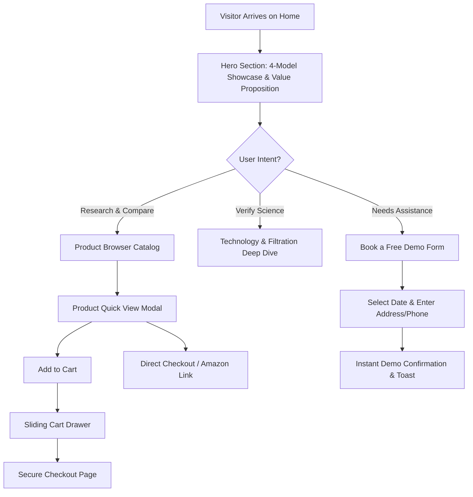

# Product Requirements Document (PRD)

## Project Name: KENT Water Purifiers — Direct-to-Consumer (D2C) & Lead Generation Platform
**Document Version:** 1.0.0  
**Status:** Approved / Active Production  
**Target URL:** `https://shoppingwebsite-kent.netlify.app` / `https://github.com/kashyapnathoo53-wq/ShoppingWebsite.git`  
**Last Updated:** November 2026  

---

## 1. Executive Summary & Vision

### 1.1 Executive Summary
The **KENT Water Purifier Platform** is a modern, high-converting Direct-to-Consumer (D2C) e-commerce and lead-generation web application. Designed to replace dated catalog experiences, the platform blends luxury editorial wellness aesthetics with intuitive e-commerce mechanics. It serves two primary business objectives:
1. **High-Intent Lead Capture**: Facilitating frictionless booking of complimentary doorstep water demonstrations and free TDS tests.
2. **Direct Product Commerce**: Enabling direct purchase of KENT RO purifiers with a slide-over cart drawer and multi-method checkout.

### 1.2 Product Vision
To be the benchmark digital flagship for India's #1 water purification brand, communicating the purity of **Mineral RO™ technology** through sophisticated visual design, instant clarity, and reliable e-commerce transactions.

---

## 2. Target Audience & User Personas

| Persona | Demographics & Context | Core Pain Points | Key Goals & Needs |
| :--- | :--- | :--- | :--- |
| **Pooja (The New Parent)** | 28–35 yrs, Urban Metro, First-time home buyer | High TDS municipal water, fear of heavy metals, infant health concerns | Wants certified mineral retention, zero hassle doorstep demo, clear specs |
| **Rajesh (The Tech-Savvy Upgrader)** | 32–45 yrs, Tier 1/2 City, IT Professional | Existing RO purifiers waste too much water; noisy operation; lack of filter change alerts | Looks for Smart IoT monitoring, Zero Water Wastage, transparent pricing |
| **Mrs. Sharma (The Traditional Homemaker)** | 45–60 yrs, Joint Family, Brand Loyalist | Confused by technical jargon, worries about counterfeit products & unauthorized service | Wants trusted brand assurance (Hema Malini endorsement), phone booking, COD/pay on install |

---

## 3. Core Value Propositions
* **Patented Mineral RO™ Science**: Multi-stage filtration (RO + UV + UF + Alkaline/TDS Controller) retaining essential natural calcium and magnesium.
* **Zero Water Wastage Technology**: Recirculating rejected water into overhead tanks.
* **Complimentary Doorstep Service**: Instant booking of a certified technician for home water testing.
* **Transparent Pricing & Warranty**: Direct discounts, comprehensive 1–4 year warranty packages, and multi-channel fulfillment.

---

## 4. User Journey Maps

---

## 5. Functional Requirements (FR)

### FR1: Global Navigation & Predictive Search
* **FR1.1 Sticky Header**: Navigation bar stays pinned with background blur and elevation on scroll.
* **FR1.2 Brand Lockup**: KENT® House of Purity typography lockup with precise spacing.
* **FR1.3 Predictive Live Search**:
  * Real-time search input with clear button (`✕`).
  * Debounced keyword matching across purifier names, technologies, and features.
  * Instant search dropdown rendering product thumbnail, title, price, and direct jump link.
* **FR1.4 Dynamic Cart Action Pill**: Displays live item count badge with animated bump feedback.
* **FR1.5 Responsive Mobile Hamburger Menu**: Accessible off-canvas navigation overlay on viewports `< 992px`.

### FR2: Hero Section & Brand Staging
* **FR2.1 Ultra-High-Definition Product Lineup**:
  * Displays all 4 uncropped hero models: **KENT Pearl IoT**, **KENT Grand IoT**, **KENT Grand**, and **KENT Supreme Plus Neo** (with water stream and 2-year warranty shield).
  * Seamless blending onto warm travertine floor with multi-point contact grounding shadows.
* **FR2.2 Liquid Water Physics Effect**:
  * 3D crystalline liquid water splash swooping gracefully over the purifiers with realistic refractions.
* **FR2.3 Brand Typography & Tagline**:
  * Editorial typography: `Mineral Technology` in solid dark charcoal, `Pure Hydration` in signature Burgundy-to-Gold gradient.
  * No trailing periods (full stops).
* **FR2.4 Trust Badge Row**: Displays `1 Crore+ Happy Families`, `25+ Years Purity & Trust`, `100% Retained Minerals`.
* **FR2.5 Floating Trust Metrics Pill**: Positioned directly underneath the CTA buttons with zero horizontal overflow.

### FR3: Product Catalog & Multi-Model Filtering
* **FR3.1 Catalog Grid**: Responsive card grid showcasing flagship KENT purifiers.
* **FR3.2 Card Data Display**:
  * High-resolution purifier media.
  * Product model name and concise capability summary.
  * Dual-price lockup: Selling Price, Strikethrough MRP, and percentage savings pill (e.g., `17% OFF`).
* **FR3.3 Interactive Triggers**: "View Details" button opening the Quick View Modal.

### FR4: Interactive Product Quick View Modal
* **FR4.1 Accessible Dialog**: Accessible modal with focus trapping, backdrop blur, and ESC key listener.
* **FR4.2 Product Presentation**: Large format image showcase, detailed feature bullet points, and specification tags.
* **FR4.3 Quantity Stepper**: Interactive `+` / `-` buttons with input boundaries (`1` to `10`).
* **FR4.4 Purchase & Fulfillment Actions**:
  * Primary CTA: "Add to Cart" with instant slide-in drawer activation.
  * Secondary CTA: "Buy Now" linking directly to checkout with selected item and quantity.
  * Marketplace Fallback: "Buy on Amazon" with verified partner redirect.

### FR5: Sliding Cart Drawer & Persistent State
* **FR5.1 Slide-Over Drawer**: Right-anchored slide-in drawer with semi-transparent backdrop.
* **FR5.2 Client-Side Persistence**: Cart state serialized in browser `localStorage`.
* **FR5.3 Line Item Management**: Increment, decrement, or delete items with real-time recalculation of subtotals and item counts.
* **FR5.4 Empty State**: Helpful empty cart message with direct "Continue Shopping" CTA.
* **FR5.5 Sticky Checkout Trigger**: Fixed bottom footer displaying total payable amount and direct checkout button.

### FR6: Patented Technology & Scientific Storytelling
* **FR6.1 Technology Comparison Matrix**: Clear breakdown of RO vs. UV vs. UF vs. Mineral RO™.
* **FR6.2 Multi-Stage Purification Diagram**: Visual stages (Sediment Filter → Carbon Filter → RO Membrane → UV Disinfection → TDS Control Valve).
* **FR6.3 Health & Mineral Retention Highlights**: Transparent data on retention of Calcium, Magnesium, and essential electrolytes.

### FR7: Interactive "Book a Free Demo" System
* **FR7.1 Multi-Input Lead Form**: Full Name, 10-digit Indian Mobile Number, City & Pincode, Complete Address.
* **FR7.2 Interactive Day/Date Selector**:
  * Quick-select day chips: **Today**, **Tomorrow**, **Day After Tomorrow**, and **This Weekend**.
  * Native date input fallback with minimum date set to today's date (`min = YYYY-MM-DD`).
  * Live dynamic confirmation preview chip showing selected day and date.
* **FR7.3 Real-Time Validation**: Instant inline error feedback for invalid phone numbers (RegEx `^[6-9]\d{9}$`) or missing address fields.
* **FR7.4 Submission State & Confirmation**: Loading spinner transition, automated simulated submission, persistent success banner, and toast notification.

### FR8: Social Proof, Reviews & FAQ Accordion
* **FR8.1 Customer Reviews Carousel**: Verified buyer ratings (5-star ratings, reviewer photo, verified location, detailed feedback).
* **FR8.2 Interactive Carousel Controls**: Smooth touch/swipe gestures, dot pagination, and next/prev arrow buttons.
* **FR8.3 Expandable FAQ Accordion**: Interactive questions regarding installation, warranty coverage, filter replacement cycles, and water testing.

### FR9: Secure Multi-Step Checkout & Payment Simulation (`checkout.html`)
* **FR9.1 Delivery Address Capture**: Form fields for shipping address, phone, email, and landmark.
* **FR9.2 Order Summary Review**: Dynamic line items, applied promotional discounts, delivery charges (Free), and total.
* **FR9.3 Payment Gateways**:
  * UPI (Google Pay, PhonePe, Paytm, BHIM, Custom UPI ID).
  * Credit/Debit Cards (Visa, MasterCard, RuPay, Amex).
  * Net Banking (All major Indian banks).
  * No-Cost EMI options (3, 6, 9, 12 months).
  * Pay on Installation / Cash on Delivery (COD).
* **FR9.4 Order Confirmation Dialog**: Animated checkmark, generated order ID, SMS/Email dispatch notification, and installation booking status.

---

## 6. Non-Functional Requirements (NFR)

### 6.1 Performance & Core Web Vitals
* **Largest Contentful Paint (LCP)**: `< 2.2s` on 4G mobile networks via WebP compression and `fetchpriority="high"`.
* **First Input Delay (FID) / INP**: `< 50ms` through vanilla JavaScript with zero heavy framework overhead.
* **Cumulative Layout Shift (CLS)**: `< 0.05` with explicit image dimensions and reserved aspect ratios.
* **Asset Optimization**: High-compression WebP images with cache-busting version parameters (`?v=XX`).

### 6.2 Accessibility (a11y)
* **Standard**: WCAG 2.1 Level AA compliance.
* **Color Contrast**: Minimum 4.5:1 ratio for all body copy and 3:1 for large display headers against pure white and travertine backgrounds.
* **Keyboard Navigation**: Complete tab-index support, visible focus rings (`:focus-visible`), and ARIA attributes (`aria-expanded`, `aria-label`, `role="dialog"`).

### 6.3 Browser & Device Support
* **Desktop**: Chrome, Edge, Safari, Firefox (last 2 versions).
* **Mobile/Tablet**: iOS Safari 14+, Android Chrome 90+, Samsung Internet.
* **Viewport Adaptability**: 320px (Mobile SE) up to 2560px (Ultra-wide 4K).

### 6.4 Security & Privacy
* **Data Sanitization**: Input validation preventing XSS.
* **Client-side Encryption / Mock**: Zero storage of raw card CVV or sensitive banking credentials.
* **HTTPS**: Strict HTTPS enforcement via Netlify SSL/TLS.

---

## 7. Success Metrics & Key Performance Indicators (KPIs)

1. **Lead Conversion Rate**: Target `> 8.5%` of visitors booking a Free Demo.
2. **E-Commerce Add-to-Cart Rate**: Target `> 4.2%` engagement from product cards/modal.
3. **Checkout Completion Rate**: Target `> 65%` conversion from Cart to Order Confirmation.
4. **Mobile Bounce Rate**: Maintained below `35%`.
5. **Page Speed Score**: Google Lighthouse score `> 92/100` across Mobile and Desktop.

---

## 8. Release & Deployment Pipeline
* **Repository**: `https://github.com/kashyapnathoo53-wq/ShoppingWebsite.git`
* **Branching Strategy**: Trunk-based development on `main`.
* **Hosting Platform**: Netlify with automatic continuous deployment on git push.
* **Asset Versioning**: Explicit asset query parameters (`v=21.0`) ensuring immediate cache invalidation.
