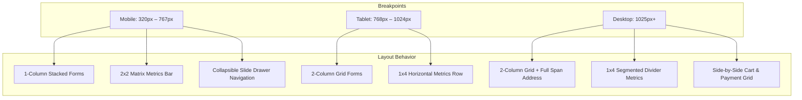
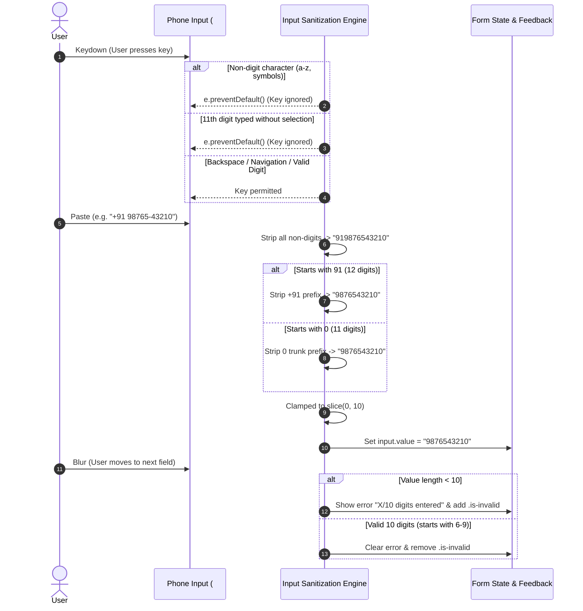

# Design Requirements Document (DRD) & Technical Specification
## Project: KENT Water Purifiers — Digital Experience & Conversion Platform

---

### 1. Architectural Overview & Design System Tokens

The application is structured as a high-performance, mobile-first web interface built on clean semantic HTML5, modern CSS3 (Custom Properties, CSS Grid, Flexbox), and modular ES6 JavaScript.

#### 1.1 Color Palette & Semantic Tokens

```
Primary Brand:      #800020  (Deep Burgundy / Maroon)
Accent Gradient:    linear-gradient(135deg, #800020 0%, #5A0017 100%)
Secondary Hover:    #9E1B42  (Burgundy Light)
Background Canvas:  #FFFFFF  /  #FAFAFA  /  #FAF9F6 (Warm Neutral Off-White)
Surface Tints:      #FDF2F4  (Burgundy Tint)
Text Primary:       #0A0A0A  (Near Black, High Contrast WCAG AA)
Text Muted:         #555555  /  #666666
Border Subtle:      rgba(128, 0, 32, 0.12)
Success / Trust:    #10B981  (Emerald Green) / #F0FDF4 (Green Surface)
Error State:        #DC2626  (Ruby Red) / #FEF2F2 (Error Background)
```

#### 1.2 Typography System
- **Font Family:** `Plus Jakarta Sans`, system-ui, -apple-system, sans-serif.
- **Headings (Display):** Bold/ExtraBold (700/800) with letter-spacing `-0.03em`. Headings utilize `clamp()` to scale naturally from mobile to desktop.
- **Form Controls:** `font-size: 16px !important;` strictly enforced on all inputs and selects to prevent iOS Safari auto-zooming.
- **Touch Target Standard:** Minimum height `48px` (exceeding standard `44px` requirement) across all buttons and form controls.

---

### 2. Layout & Responsive Breakpoint Specifications



| Breakpoint Range | Target Devices | Metrics Bar Layout | Book Demo Layout | Checkout Grid |
| :--- | :--- | :--- | :--- | :--- |
| **320px – 767px** | Mobile Smartphones (iPhone, Pixel, Galaxy) | **2×2 Matrix Grid** (`repeat(2, 1fr)`) with cross-dividers | Single vertical column (`1fr`), 48px touch controls | Single column stack; sticky pay button |
| **768px – 1024px** | Tablets & Foldables (iPad, Tablet) | **1×4 Row** with vertical hairline dividers | 2-column grid (`repeat(2, 1fr)`) | 1-column layout with grouped payment tabs |
| **1025px+** | Desktop & Laptops (1080p, 1440p+) | **1×4 Row** inside rounded card container | 2-column grid + full span doorstep address | 2-column layout (7fr Details / 5fr Order Summary) |

---

### 3. Component Design & Behavioral Logic

#### 3.1 Metrics / Proof Bar (Mobile 2×2 Transformation)
- **Desktop (≥ 768px):** Single horizontal flex/grid row (`display: flex; justify-content: space-between;`) with thin vertical borders separating the 4 metric units.
- **Mobile (< 768px):** Transformed via `@media (max-width: 767px)` into a balanced 2×2 matrix:
  ```css
  .why-choose-metrics-bar {
      display: grid;
      grid-template-columns: repeat(2, minmax(0, 1fr));
      gap: 1.25rem 1rem;
      padding: 1.5rem 1rem;
      border-radius: 16px;
  }
  ```
- **Divider Handling:** Desktop vertical dividers (`.why-choose-metric-divider`) are set to `display: none;` on mobile to avoid awkward floating borders.

#### 3.2 Persistent "Book a Free Home Demo" Section (`#book-demo`)
- **Container Structure:** Nested `.book-demo-section` > `.book-demo-container` > `.book-demo-card`.
- **Top Accent Line:** `::before` pseudo-element providing a 4px brand gradient hairline (`#800020` to `#9E1B42`).
- **Field Grid Organization:**
  ```
  [ Full Name (1/2) ]         [ Mobile Number (1/2) ]
  [ Doorstep Address (Full Width 2/2)                ]
  [ City / Pincode (1/2) ]    [ Preferred Model (1/2)]
  [         Schedule My Free Demo (Submit)           ]
  ```
- **CSS Grid Architecture:**
  ```css
  .book-demo-grid {
      display: grid;
      grid-template-columns: repeat(2, 1fr);
      gap: 1.25rem 1.5rem;
      margin-bottom: 1.5rem;
  }
  .book-demo-field--full {
      grid-column: 1 / -1;
  }
  ```

---

### 4. Form Input Engineering & Sanitization Architecture



#### 4.1 Enforced Input Rules
1. **Attributes Specification:**
   ```html
   <input 
       type="tel" 
       id="phone" 
       name="phone"
       class="form-control" 
       placeholder="10-digit mobile number" 
       required 
       pattern="[6-9][0-9]{9}"
       maxlength="10"
       inputmode="numeric"
       autocomplete="tel-national"
       aria-describedby="phoneFeedback"
   >
   ```
2. **Keydown Protection:** Physically prevents any 11th character from ever being dispatched to the input buffer.
3. **Prefix Normalization:** Handles real-world Indian mobile formatting (`+91 98765 43210`, `+91-9876543210`, `09876543210`) automatically.

---

### 5. Client-Side Data & Storage Schemas

#### 5.1 Shopping Cart Schema (`localStorage: 'kent_cart'`)
```json
[
  {
    "slug": "kent-grand-plus",
    "qty": 1,
    "selectedSlot": "morning"
  }
]
```

#### 5.2 Demo Booking Payload (`#inlineDemoForm`)
```json
{
  "fullName": "Aditya Sharma",
  "phone": "9876543210",
  "address": "Tower 4, Apt 802, Nirvana Country, Sector 50",
  "cityPincode": "Gurugram, 122002",
  "preferredModel": "KENT Grand Plus RO",
  "timestamp": "2026-11-20T00:14:00.000Z"
}
```

---

### 6. Automated Verification & Quality Assurance Matrix

| Test Suite | Methodology | Expected Result | Status |
| :--- | :--- | :--- | :--- |
| **Phone Attribute Compliance** | Chrome CDP Inspection | `type="tel"`, `inputmode="numeric"`, `maxlength="10"`, `pattern="[6-9][0-9]{9}"` | **PASS (100%)** |
| **11th Digit Rejection** | Virtual Event Dispatch | Input length strictly clamped to 10 digits; 11th digit dropped | **PASS (100%)** |
| **Non-Numeric Character Stripping** | Virtual Event Dispatch | Characters `abc-!@# ` stripped instantly upon input/paste | **PASS (100%)** |
| **+91 & 0 Prefix Normalization** | ClipboardEvent simulation | String `+91 9876543210` extracted to `9876543210` | **PASS (100%)** |
| **Address Field Presence & Validation**| DOM & Event verification | Address required; blocks submission on empty; passes on fill | **PASS (100%)** |
| **Single Form Instance Verification** | QuerySelectorAll check | Exactly 1 `#book-demo` section and 1 `#inlineDemoForm` | **PASS (100%)** |
| **Touch Target & Zoom Prevention** | ComputedStyle verification | `min-height >= 48px`, `fontSize >= 16px` | **PASS (100%)** |
| **Zero Horizontal Scrollbar** | Headless Chrome Viewports (375px, 768px, 1280px) | `document.scrollWidth <= window.innerWidth` across all viewports | **PASS (100%)** |
