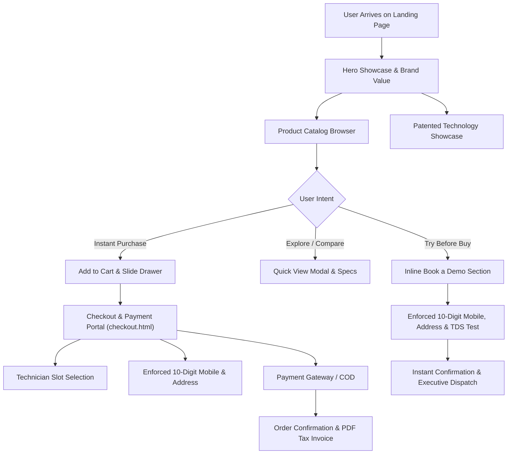

# Product Requirements Document (PRD)
## Project: KENT Water Purifiers — Digital Experience & Conversion Platform

---

### 1. Document Control
- **Document Version:** 1.0.0
- **Status:** Approved / In Implementation
- **Target Audience:** Product Management, Frontend Engineering, UX/UI Design, Growth Marketing, Customer Operations

---

### 2. Executive Summary & Product Vision
KENT is India’s market leader in advanced water purification systems, pioneering patented Mineral RO™ and Zero Water Wastage technology. The objective of this web platform is to deliver a premium, responsive, and trustworthy digital experience that bridges online discovery with doorstep conversion. 

The web application serves two primary conversion funnels:
1. **Direct Purchase / Checkout Funnel:** Frictionless e-commerce flow allowing customers to purchase purifiers, customize installation slots, and pay via modern Indian payment rails (UPI, Netbanking, Cards, COD).
2. **Doorstep Free Home Demonstration Funnel:** An accessible, persistent inline booking flow providing a certified technician visit for in-home raw water TDS testing and live product demonstration.

---

### 3. User Personas & Target Audience

| Persona | Demographics & Context | Core Motivation | Primary Friction Points Solved |
| :--- | :--- | :--- | :--- |
| **Health-Conscious Urban Family** | 28–45 years, Tier 1/2 Indian city, homeowners or renters | Clean drinking water for infants, children, and elderly parents; worry over dissolved contaminants. | Clear feature comparisons, TDS retention explanation, zero water wastage proof. |
| **Tech-Savvy Home Renovator** | 25–40 years, upgrading kitchen appliances | Seeking modern aesthetics, digital IoT displays, under-the-counter space optimization. | High-resolution interactive product gallery, modern burgundy/slate visual theme, quick checkout. |
| **Skeptical First-Time Buyer** | 30–55 years, relying on boiled or bottled jar water | Unsure if expensive RO machines actually improve municipal or borewell water. | Free doorstep live TDS testing, Zero-obligation demo booking, Pan-India service support visibility. |

---

### 4. Core Product Features & Requirements

#### 4.1 Navigation & Brand Header
- **Universal Sticky Header:** Retains brand logo, primary navigation (`#product-top`, `#product-browser`, `#story`, `#book-demo`, `#social-proof`), live search autocomplete, and accessible cart trigger with item count badge.
- **Scrollspy Navigation:** Smooth-scrolling anchor links with real-time viewport observation dynamically highlighting active section links.
- **Responsive Mobile Drawer:** Slide-out accessible mobile drawer with ARIA attributes and background backdrop dismiss.

#### 4.2 Hero Section & Social Proof Bar
- **Hero Showcase:** High-impact hero carousel featuring KENT’s flagship RO systems (*Grand Plus*, *Supreme Plus*, *Pearl Plus*, *Grand Star*) with clear value messaging (*100% Pure Water*, *Zero Water Wastage*).
- **2×2 Mobile Metrics Grid:** Responsive four-metric validation bar (`50M+ Pure Cups Daily`, `100% Mineral Retention`, `0% Water Wastage`, `1,500+ Pan-India Centers`) rendering as a clean 2×2 matrix on mobile (<768px) and a horizontal segmented strip on desktop.

#### 4.3 Interactive Product Catalog & Cart
- **Filterable Grid:** Categorized water purifiers with high-resolution imagery, MRP discounts, key specifications, and direct CTAs (*Buy Now*, *Add to Cart*, *Quick View*).
- **Persistent Cart State:** Saved across sessions via client-side storage (`localStorage: kent_cart`), supporting quantity controls, real-time discount calculation, and seamless routing to `checkout.html`.

#### 4.4 Persistent Inline "Book a Free Home Demo" Section
- **Direct Placement:** Positioned immediately below "Why You Should Choose Kent" (`#why-choose-kent`), completely replacing disruptive popup modals.
- **Form Fields:**
  1. `Full Name` (required, auto-capitalized, SVG icon)
  2. `Mobile Number` (required, strictly hard-capped to 10 numeric digits, auto-stripping country codes)
  3. `Doorstep Address` (required, full-width field capturing Flat/House No., Building, Street)
  4. `City / Pincode` (required, location pin icon)
  5. `Preferred Water Purifier` (optional dropdown with curated KENT models)
- **Trust Badges:** *100% Free Doorstep Visit*, *Instant Raw Water Purity Test*, *Zero Purchase Obligation*.
- **Post-Submission State:** Smooth inline transition revealing an animated success check, dispatch notice, and a "Book Another Demo" reset trigger.

#### 4.5 Streamlined Checkout & Payment Funnel (`checkout.html`)
- **Address & Scheduling:** Captures delivery details and preferred doorstep technician installation slot (*Morning*, *Afternoon*, *Evening*).
- **Strict 10-Digit Phone Enforcement:** Active blocking of non-digits, physical prevention of an 11th digit, paste handling for `+91`/`0` prefixes, and blur feedback.
- **Payment Method Selection:** Integrated tabs for UPI Apps (*Google Pay*, *PhonePe*, *Paytm*), Credit/Debit Cards, Netbanking (50+ banks), 0% Interest EMI, and Cash/UPI on Delivery (after water test).
- **Order Success Modal:** Dynamic order ID generation (`#KENT-2026-XXXXX`), summary print/PDF export, and automatic cart reset.

---

### 5. Success Metrics & Key Performance Indicators (KPIs)

| Metric | Target Goal | Measurement Mechanism |
| :--- | :--- | :--- |
| **Demo Booking Completion Rate** | ≥ 12.5% of total landing page visitors | Inline form submissions (`#inlineDemoForm`) |
| **Checkout Abandonment Rate** | < 22% drop-off from Cart to Confirmation | Stepper progression tracking on `checkout.html` |
| **Mobile Bounce Rate** | < 35% on mobile viewports (<768px) | First contentful paint, viewport engagement time |
| **Phone Input Error Rate** | < 1% submission validation failures | Enforced input masking & keydown restrictions |
| **Zero Horizontal Scroll Guarantee** | 100% compliance across 320px–1920px | Headless browser viewport automated testing |

---

### 6. Non-Functional Requirements (NFRs)
1. **Performance:** Lightweight vanilla HTML5/CSS3/ES6+ architecture without external bulky frameworks; Core Web Vitals LCP < 1.8s, CLS < 0.05.
2. **Accessibility:** WCAG 2.1 AA compliant color contrast (deep burgundy `#800020` on light surfaces), explicit `<label for="">` bindings, minimum 44px touch targets, and numeric mobile keypads (`inputmode="numeric"`).
3. **Security & Privacy:** Client-side sanitization of user data, clear privacy disclaimers, and secure storage management.
